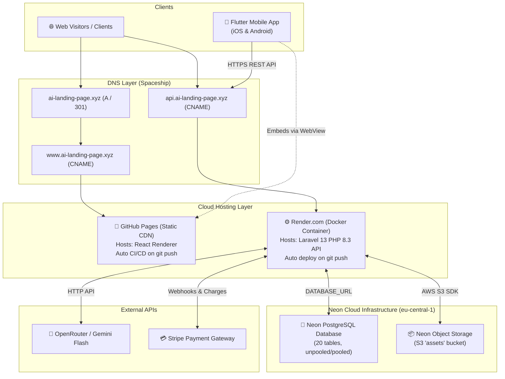

# Architecture & Deployment Guide: AI Website Builder

This document outlines the complete architectural layout of the project, including repository structure, hosting infrastructure, domain configuration, and data flow between all components.

---

## 1. System Overview & Connectivity



---

## 2. Repository Directory Structure

```text
ai_builder2/
├── .github/
│   └── workflows/
│       └── deploy-renderer.yml       # GitHub Actions: auto builds & deploys renderer to Pages
├── backend/                          # Laravel 13 API Backend
│   ├── app/
│   │   ├── Http/Controllers/        # Auth, Templates, AI, Websites, Stripe, Admin
│   │   ├── Models/                  # Eloquent models (User, Website, Template, etc.)
│   │   └── Services/                # AI Engine, Billing, Compilers, Hosting
│   ├── config/                      # database.php (Neon), filesystems.php (Neon S3)
│   ├── database/
│   │   ├── migrations/              # 20 database migrations
│   │   └── seeders/                 # Seeders for templates, categories, users
│   ├── routes/                      # api.php, web.php
│   ├── Dockerfile                   # Production Docker image for Render
│   └── entrypoint.sh                # Container entrypoint (migrations + serve)
├── renderer/                         # React 19 + Vite Static Renderer
│   ├── public/
│   │   └── CNAME                    # Custom domain pointer (www.ai-landing-page.xyz)
│   ├── src/
│   │   ├── components/              # Modular section components (Hero, Features, etc.)
│   │   ├── engine/                  # Theme engine, layout compiler, WebsiteRenderer
│   │   └── types/schema.ts          # Strongly typed website document schema
│   ├── package.json
│   └── vite.config.ts
├── mobile/                           # Flutter Mobile Application
│   ├── lib/
│   │   ├── core/
│   │   │   ├── network/api_client.dart # Configured with production baseUrl
│   │   │   ├── services/stripe_service.dart
│   │   │   └── storage/session_manager.dart
│   │   └── features/
│   │       ├── ai_creation/         # AI website creation screens
│   │       ├── editor/              # Real-time visual canvas editor
│   │       ├── dashboard/           # Project management dashboard
│   │       └── website_config/      # Custom domain and DNS management
│   └── pubspec.yaml
├── neon.ts                           # Infrastructure-as-Code for Neon (Postgres + S3 bucket)
├── render.yaml                       # Blueprint configuration for Render deployment
└── ARCHITECTURE.md                   # This documentation file
```

---

## 3. Hosting & Infrastructure Breakdown

### A. Frontend (Renderer & Landing Page)
- **Host**: **GitHub Pages**
- **Domain**: `https://www.ai-landing-page.xyz` (with automatic redirect from `ai-landing-page.xyz`)
- **Technology**: React 19, TypeScript, Vite.
- **Deployment**: Automatic CI/CD workflow defined in `.github/workflows/deploy-renderer.yml`. Every git push to `main` triggers:
  1. `npm ci`
  2. `npm run build`
  3. Uploads `renderer/dist` to GitHub Pages CDN with free Let's Encrypt SSL.

### B. Backend API (Laravel)
- **Host**: **Render.com** (Free Tier Web Service)
- **Domain**: `https://api.ai-landing-page.xyz`
- **Technology**: PHP 8.3 CLI Alpine container (`backend/Dockerfile`).
- **Configuration**: Defined in [`render.yaml`](file:///Users/lounis/Documents/ai_builder2/render.yaml). Runs automatically on git pushes to `main`.
- **Boot Sequence**: `backend/entrypoint.sh` automatically runs pending migrations, caches configs and routes, and boots the HTTP server on port 8080.

### C. Database & Object Storage
- **Host**: **Neon.tech Cloud** (`eu-central-1`)
- **Database**: Serverless PostgreSQL managed via [`neon.ts`](file:///Users/lounis/Documents/ai_builder2/neon.ts).
- **Object Storage**: S3-compatible bucket named `assets` hosted directly within the Neon project branch.
- **Integration**: Connected via Laravel's native PDO PostgreSQL driver and Flysystem AWS S3 driver (`league/flysystem-aws-s3-v3`).

---

## 4. DNS Routing (Spaceship)

| Type | Host | Target Value | Purpose |
|---|---|---|---|
| `A` | `@` | `185.199.108.153` | Apex domain pointer to GitHub Pages |
| `CNAME` | `www` | `aymendouibi.github.io` | Primary renderer frontend with SSL |
| `CNAME` | `api` | `ai-builder-api.onrender.com` | Backend API with Render SSL |

---

## 5. How Everything Connects

### 1. User & Mobile App to Backend
- The mobile app (`ApiClient`) makes authenticated HTTPS calls to `https://api.ai-landing-page.xyz/api/v1`.
- Authentication is handled via **Laravel Sanctum** bearer tokens stored in secure local storage (`SessionManager`).

### 2. Mobile Editor to Renderer Canvas
- Inside the Flutter app, the editor embeds the web renderer via an interactive WebView.
- Communication uses a two-way JavaScript bridge (`AndroidBridge` / `webkit.messageHandlers`):
  - Mobile app sends the updated `WebsiteDocument` JSON to the renderer.
  - Renderer renders pixel-perfect DOM in milliseconds without page refreshes.
  - When a user taps a section on the canvas, the renderer emits `SECTION_SELECTED` events back to Flutter to open the contextual property inspector.

### 3. AI Modification Flow
1. User types an edit instruction in the mobile app (e.g. *"Change color theme to emerald and rewrite headline"*).
2. Flutter forwards the request to `POST https://api.ai-landing-page.xyz/api/v1/ai/edit`.
3. Laravel's `StructuredAiEditor` merges the current document AST with the prompt and calls OpenRouter / Gemini.
4. The modified document is validated against the schema and returned to the client for immediate live preview with **Discard** and **Apply** controls.

### 4. File Upload & Media Flow
- Images and assets uploaded by users are sent to `/api/v1/media-assets`.
- Laravel stores them in the Neon Object Storage `assets` bucket using S3 path-style addressing.
- Returns a durable public/signed URL stored in the website document.
